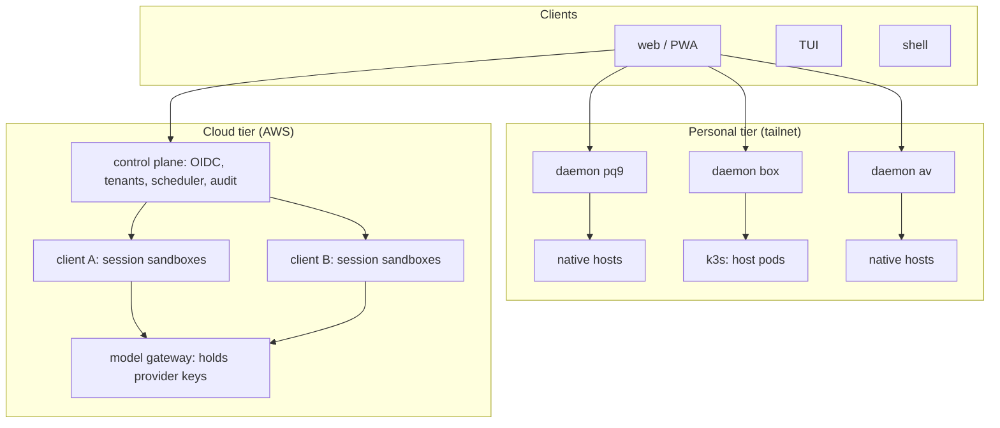

# Host placement and security: personal fleet and multi-tenant cloud

Status: proposal, not approved. Written 2026-11-03. Extends `session-host.md` (rings model, "Remote agents") and `protocol-transport-proposal.md` (plan step 3). Nothing here is implemented.

## Goal

Run omp hosts in two tiers that share one protocol and one client:

| Tier | Machines | Users | Trust |
|---|---|---|---|
| Personal | `pq9` (nix-darwin, main dev machine), `box` (NixOS, Kubernetes), `av` (Arch), more later | one: the owner | the owner trusts every machine and every session |
| Cloud | AWS | many clients (organizations), many users per client | clients do not trust each other; users in one client have roles |

## Answer: is a different architecture needed?

Rings 1 to 3 stay the same: the host protocol (v3, later v4) and the clients (web, TUI, shell) do not change between tiers. Three things differ, and they differ enough to need separate implementations:

| Concern | Personal | Cloud |
|---|---|---|
| Identity | the tailnet device and user (`Tailscale-User-Login`) plus a device passkey | OIDC login, user belongs to a client, role per client |
| Isolation unit | none needed between sessions; a session works on the owner's real files | one sandbox per session, one network and account boundary per client |
| Credentials | the owner's local keys | keys provisioned per client, never readable from the sandbox |
| Control plane | one webgui daemon per machine (today) | one central service: auth, scheduling, billing, audit |
| Discovery | registry dir per machine, daemon list in the browser (today) | control plane database |

## Known (current code and docs)

- The daemon is same-machine: discovery reads `run/rpc-hosts`, launch spawns `omp host start`, and recap, export and complete read local files (`protocol-transport-proposal.md`, Known).
- Browser-side trust is a loopback bind plus the Host/Origin allowlist (`packages/webgui/src/server/security.ts`). There is no login. Host-side trust is file mode 0600 plus a bearer token.
- `clientId` and `surface` are unauthenticated claims.
- The rings model puts credentials and the shell in the same ring (ring 0, `session-host.md`). The agent's shell tool runs as the same user as the process that holds the provider keys.

The last fact is acceptable in the personal tier and is the main blocker for the cloud tier: any prompt injection in a tenant session can read that tenant's provider key.

## Design

### 1. Shared contract

- **Host protocol:** unchanged per tier. v4 (sequence ids, lanes, resume) is a prerequisite for the cloud tier because cloud links drop more than loopback.
- **Placement API:** every daemon and the cloud control plane serve the same REST surface the webgui uses today: list, launch, resume, stop, export.
- **Remote hosts through a daemon:** a daemon relays any host that speaks the protocol, local socket or remote endpoint. The owner's pq9 daemon lists cloud sessions next to local ones: it holds the owner's cloud token, asks the control plane for the session endpoint, and relays the stream as it relays a local host today. The cloud host checks that token, not the daemon's tailnet identity.
  - Customers never route through pq9. Their clients connect to the control plane gateway directly; for them the cloud is one entry in `webgui.servers` with its own login.
  - Cost of the relay path: phone to pq9 to AWS adds a hop, and the owner's cloud sessions are unreachable from the daemon while pq9 is down. Direct connection to the gateway stays available as a fallback.
- **Placement backend inside a daemon:** `native` (spawn `omp host start`, as today) or `k8s` (create a pod). The backend choice is per machine config, invisible to the client.

### 2. Personal tier

- **pq9 and av:** native backend, unchanged. nix-darwin has no Kubernetes or KVM; Arch could run k3s later but gains nothing for one user.
- **box:** k3s from the NixOS `services.k3s` module. One pod per session, running `omp host start` with the workspace mounted from a host path or PVC. The daemon on box runs outside the cluster and talks to the Kubernetes API.
  - Why: practice with the same objects (pods, secrets, network policies) the cloud tier can use on EKS, and restart and resource limits for long sessions.
  - Cost on box: k3s idles at roughly 500 MB RAM and some CPU [INFERENCE, not measured]. Measure after install.
- **Identity:** keep the tailnet ACL as layer 1. Add per-device passkeys (WebAuthn) checked by every daemon as layer 2, because today any device on the tailnet can drive agents. The daemon trusts `Tailscale-User-Login` only when the request came through `tailscale serve` on loopback; tagged devices carry no such header.
- **Cross-machine:** each daemon accepts a passkey session issued by any personal daemon (shared signing key distributed by Nix/agenix), so one login covers the fleet.
- **Credentials:** local keys, as today. Unchanged.

### 3. Cloud tier

- **Tenancy:** one AWS account per client under AWS Organizations. Account boundaries limit damage from a broken sandbox and give per-client billing for free. A shared account with per-tenant VPCs is cheaper to operate but one IAM mistake crosses clients.
- **Isolation unit, per session**, options:

  | Option | Isolation | Cold start | Persistent disk + pty | Ops |
  |---|---|---|---|---|
  | EC2 instance per session | VM | ~30-60 s [INFERENCE] | yes (EBS) | simple, costly at idle |
  | EKS + Kata/Firecracker or gVisor pods | microVM / user-space kernel | seconds | PVC | complex |
  | Fargate task | microVM | ~30 s+ [INFERENCE] | no persistent disk | rejected: no long-lived state |

  Recommendation: start with EC2 per session plus stop on idle and start on resume (EBS keeps state). Move to EKS with Kata when session count makes per-instance idle cost matter. Plain container pods without a sandbox runtime are rejected: tenant code runs a shell.
- **Identity:** OIDC (Cognito or an external IdP per client). Roles per client: owner, member, viewer. The control plane issues short-lived tokens; the session sandbox accepts only those, scoped to `client/session`.
- **Credentials:** provider keys per client live in Secrets Manager in the client's account. The sandbox never holds them. omp in the sandbox talks to a model gateway that adds the key, enforces per-client spend limits, and logs usage. This moves "credentials" out of ring 0 for the cloud tier only.
- **Egress:** default deny from sandboxes, allow the model gateway, the git host, and package registries per client policy. Without this, a prompt injection exfiltrates the workspace.
- **Code in:** git clone using a per-client deploy key or GitHub App installation token, minted per session; or file upload through the control plane into the session volume, with a per-client size cap. Uploads count as untrusted input to the agent.
- **Audit:** the control plane records who launched, prompted, and approved what, per client.
- **Roles:** owner, admin, member, viewer per client. Admins set the approval policy (which tools need human approval, egress allowlist, spend limit) for every session in their client; members cannot loosen it. Enforcement stays in ring 0 of the session, with policy delivered by the control plane at launch.

### 4. ptyZZZ terminal

Personal tier: allowed after passkeys land, opt-in per daemon. Cloud tier: the terminal runs inside the session sandbox, so it gains no access beyond the agent's own shell; allowed per client role.

## Order

1. Passkeys on every personal daemon (fixes the open "no login" item; needed by everything else).
2. Protocol v4 (`protocol-transport-proposal.md` step 2).
3. k3s on box with the `k8s` placement backend.
4. Cloud control plane with one tenant (the owner), EC2 per session, model gateway, egress policy.
5. Second tenant, OIDC per client, roles, audit.

## Risks

- **Credential exposure** in the cloud tier if the model gateway is skipped. Highest risk.
- **Model gateway support (checked 2026-11-03):** upstream already supports it with no code change. A provider entry in `models.yml` overrides `baseUrl`, `headers`, `apiKey` and `authHeader` for built-in providers (`ProviderOverride`, `packages/coding-agent/src/config/model-patch.ts:14-25`); `baseUrlApis` limits the override to chosen APIs. `apiKey` and header values may be `!command`, run on demand with a 10 s timeout and cached (`resolve-config-value.ts`), so the sandbox can fetch a short-lived per-session gateway token instead of holding a provider key. Open: whether a cached command value is refreshed on a 401 (`invalidateCommandConfig` exists; the caller path is unchecked), and which other features send their own provider keys (web search, image tools, tiny model, model discovery) and must also go through the gateway or be off.
- **Cost:** idle EC2 and EBS per session; the stop-on-idle policy is required, not optional.
- **Operational load:** a multi-tenant control plane is a separate product (auth, billing, support). Steps 1 to 3 do not depend on it.
- **Compliance:** clients are paying customers, so SOC 2, data residency (region per client), retention and deletion of session files and uploads, and a DPA are in scope before step 5.

## Unknown (to check)

Gateway and credentials:
- Whether a cached `!command` value is fetched again after the gateway answers 401. `invalidateCommandConfig` exists; the caller path is unchecked. If nothing calls it on 401, this is the likely upstream change.
- Which features call providers with their own keys and bypass `models.yml`: web search, image tools, tiny model, model discovery, catalog fetch. Each goes through the gateway or is off in cloud sessions.
- Providers that do not fit a plain base URL plus bearer token: OAuth subscription logins, Bedrock (SigV4), Vertex, the websocket transport (`preferWebsockets`). Decide gateway support or exclusion per provider.
- Build or adopt the gateway: compare existing gateways (LiteLLM proxy, Portkey, Cloudflare AI Gateway) for per-client keys, spend limits and usage logs before writing one.

Identity:
- WebAuthn passkeys in an iOS home-screen PWA: support and whether credentials survive PWA reinstall.
- That `tailscale serve` strips a client-sent `Tailscale-User-Login` header, so the daemon cannot be spoofed through it.
- Where the pq9 daemon stores the owner's cloud token and how it refreshes it.
- How the shared passkey-session signing key reaches av (Arch): whether av runs Nix/agenix or needs another secret path.

Placement:
- k3s idle RAM and CPU on box (estimate only; measure after install).
- EC2 per-session cold start and stop/start resume time; Fargate start time (estimates only).
- Kata or gVisor on EKS: node type requirements (Kata needs nested virtualization or metal instances) and cost.
- The relay (`packages/webgui/src/server/relay.ts`) connects only to local Unix sockets; a remote endpoint needs TLS and token support. Known work, size unchecked.
- exe.dev as an alternative cloud backend: WebSocket upgrade through its proxy, stripping of client-sent `X-ExeDev-*` headers, CPU architecture, pi-natives build there. See research row in `~/Code/giverny/research/omp-fork/harnesses.csv`.

Transport: the three unknowns in `protocol-transport-proposal.md` (Bun QUIC, iOS WebTransport, `tailscale serve` and HTTP/3) still stand.

Compliance:
- SOC 2 scope and timeline, list of regions offered, retention period for session files and uploads, upload scanning.

## Decisions (2026-11-03)

1. Cloud clients are paying customers; compliance is in scope (Risks).
2. Code enters cloud sessions by git or file upload (section 3, Code in).
3. The owner reaches cloud sessions through the pq9 daemon relay; customers connect to the control plane directly (section 1).
4. Client admins set approval policy for their users' sessions (section 3, Roles).
