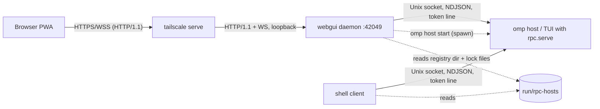

# Proposal: host protocol and transport (QUIC candidate)

Status: not implemented (proposal, not approved). Written 2026-10-16; facts rechecked 2026-10-20. No sequence ids, heartbeat, priority lanes, QUIC/WebTransport or spool cap exist in `packages/coding-agent/src/modes/rpc/` or `packages/webgui/src/`. Current limits: frame cap and 64MiB reassembly in `rpc-frame.ts:6-8` (chunks of 256KiB, `rpc-frame.ts:10`), 50ms coalesce window in `relay.ts:39`, 60s hidden suspend in `session-store.ts:86`, shell 1MiB v1 frame cap in `packages/shell/src/host-socket.ts:17`.

## Current layers

## Known

- Browser to daemon: HTTP/1.1 from `Bun.serve`. TLS ends at `tailscale serve`. JSON REST routes do list, launch, resume, shutdown, export, complete and dirs. Each attached session gets one WebSocket at `/ws/:instanceId`. There is no SSE, no service worker, no heartbeat and no online/offline listener. The page suspends after 60s hidden and resyncs on return (`packages/webgui/src/lib/rpc-client.ts`, `session-store.ts`).
- Daemon to host: `packages/webgui/src/server/relay.ts` copies bytes between the WebSocket and a host Unix socket as NDJSON. The daemon injects the auth line, forcing `surface=web` and adding a per-browser `clientId`. It also batches output every 50ms, compresses it with raw deflate, and has 1MiB of backpressure. Each WebSocket maps to exactly one host connection.
- Host (`packages/coding-agent/src/modes/rpc/`):
  - Unix socket with mode 0600, first-line bearer token, one lock file per session.
  - Frames are capped at 1MiB; protocol v2 splits larger ones into chunks up to 64MiB (`rpc-frame.ts`).
  - When clients read slowly, output spools to disk with no size limit (`rpc-output.ts`). Incoming data has no flow control.
  - The last client to send a driver command receives the dialogs (`rpc-host-driver.ts`, `rpc-host-requests.ts`).
  - Detach state lives only in host memory (`rpc-host.ts`).
- Shell (`packages/shell`): same socket and token, but one connection per `?` call and still on protocol v1. If the connection drops mid-turn the shell exits with status 1, the turn keeps running on the host, and only `/last` gets the output back.
- Resume: protocol v3 resumes with `history {after: leafId}`, a cursor into the entry tree, not into the transport (`rpc-v3.ts`). Wire frames have no sequence ids and nothing is replayed.
- Same-machine coupling: discovery (a polled registry dir with pid and connect probes), session locks, launch (spawning `omp host start`), and recap, count, complete and export all read local files.
- Trust: on the browser side, the only gate is loopback bind plus the Host/Origin allowlist (`security.ts`). On the host side it is file permissions plus the token. `clientId` and `surface` are unauthenticated claims.

## Unknown

- Whether Bun can serve QUIC, HTTP/3 or WebTransport.
- Whether iOS Safari supports WebTransport.
- Whether `tailscale serve` proxies HTTP/3 or UDP.

## Hypotheses

- Head-of-line blocking: events, responses and chunked large frames share one ordered stream. A 64MiB chunked frame blocks dialogs and aborts behind it. QUIC streams would remove that; priority lanes inside the current protocol would also fix it.
- Network changes: QUIC connection migration could keep a session alive across Wi-Fi to cellular switches. The leafId resync already makes reconnecting cheap, so the gain may be small.
- Cloud hosts need these whatever the transport:
  - a remote endpoint in the registry and remote discovery
  - mTLS or per-client tokens
  - a resume cursor for shell turns
  - a cap on the disk spool
  - remote versions of the file-reading routes

## Plan

1. Check the three unknowns. If iOS Safari has no WebTransport, the browser stays on WSS.
2. Define a transport-agnostic host protocol: per-frame sequence ids, resume-from-seq, heartbeat, and separate priority lanes for control and bulk data.
3. Add remote host auth (mTLS through Tailscale identity or the AWS equivalent), remote discovery and a spool cap.
4. Pick QUIC or HTTP/2/WSS for the daemon-to-cloud link only, based on measured latency and reconnect behavior over cellular.

## Step 2 design (for review)

Protocol v4. Same socket, same WebSocket, same NDJSON. Negotiated in the auth line like v2 and v3, so v1-v3 clients (shell, older pages) see no change.

- **Numbers:** every host-to-client frame gets `seq` (per connection identity, starts at 1) and `lane`. Chunks of one large frame share a lane.
- **Lanes:** `control` (responses, dialogs, cancel acks, heartbeat), `live` (streaming deltas, tool progress, state), `bulk` (large results, history pages, images). The host writer sends control first, then live, then bulk; it may interleave bulk chunks with the others. The relay's 1MiB buffer follows the same order, so a queued bulk batch cannot hold back a control frame.
- **Ack and replay:** the client sends `ack {seq}` every few seconds. The host keeps unacked frames in a ring per `clientId`, capped by bytes and age (start at 8MiB / 120s, then measure). This ring also gives the missing spool cap.
- **Resume:** reconnect sends `resume {clientId, afterSeq}` in the auth line. In ring: replay from `afterSeq + 1`. Out of ring: reply `resume_gap` and the client falls back to today's v3 `history {after: leafId}` resync.
- **Heartbeat:** both sides send `ping` on the control lane every 15s when idle; 45s of silence closes the connection and starts resume. The page also pings on `visibilitychange` and `online`.
- **End to end:** the browser holds `seq`; the daemon relay stays a pipe. A browser reconnect opens a new host connection with `resume`, so drops on either hop are covered.

Security: resume needs the same bearer token as a fresh connect, so it exposes nothing new. `clientId` stays an unauthenticated claim; one token holder could resume another's stream, same trust level as today.

Cost: one ring per connected client in host memory (bounded above); `seq`/`lane` add about 20 bytes per frame before deflate.

Not in step 2: shell resume (shell stays on v1), QUIC, remote auth.

Tests: `rpc-socket` tests for replay, `resume_gap` fallback, heartbeat timeout, and a control frame overtaking a 64MiB bulk frame; webgui store test for reconnect with resume; bench fake host run with a forced mid-stream drop.

Open: ring size and heartbeat timing need measurement over cellular; whether the relay's 50ms coalesce window adds noticeable control latency.
